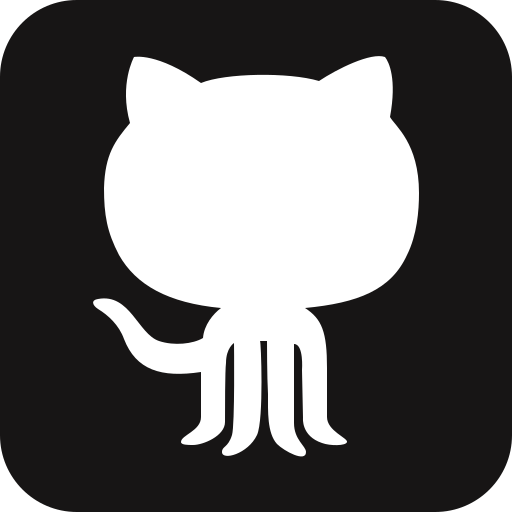

<h1 align="center">Matías Sanmiguel</h1>

<p align="center">
  <samp>BACKEND SYSTEMS / INFRASTRUCTURE / TELECOMMUNICATIONS</samp>
</p>

<p align="center">
  Building software in Buenos Aires.<br />
  <strong>Intern at Personal</strong> · <strong>Founder of Imas+</strong><br />
  <sub>Imas+ is the official computer science student club at UADE.</sub>
</p>

<h2 align="center">About me</h2>

```go
package matias

type Profile struct {
    BasedIn string
    Work    string
    Founded string
    Focus   []string
}

var Me = Profile{
    BasedIn: "Buenos Aires, Argentina",
    Work:    "Personal — Intern",
    Founded: "Imas+ — UADE's official computer science student club",
    Focus: []string{
        "Backend services & data modeling",
        "Network monitoring & diagnostics",
        "Infrastructure & automation",
    },
}
```

I like working where software meets operations: designing data models, connecting services, and building tools that make systems easier to understand and run. My projects range from payment infrastructure to network diagnostics and desktop utilities.

<h2 align="center">You can reach me at 👽</h2>

<p align="center">
  <a href="https://matias-sanmiguel.github.io/portfolio/" title="Portfolio"></a>
  &nbsp;&nbsp;
  <a href="https://www.linkedin.com/in/matias-sanmiguel/" title="LinkedIn"></a>
  &nbsp;&nbsp;
  <a href="mailto:matiassanmiguel240@gmail.com" title="Email"></a>
</p>

<h2 align="center">My stack 👨‍💻</h2>

<p align="center">
  <strong>Backend</strong><br />
  <code>Java</code> <code>Spring Boot</code> <code>Go</code> <code>Python</code>
</p>
<p align="center">
  <strong>Data</strong><br />
  <code>PostgreSQL</code> <code>Neo4j</code> <code>Redis</code> <code>MongoDB</code> <code>Cassandra</code>
</p>
<p align="center">
  <strong>Systems & tools</strong><br />
  <code>Linux</code> <code>Docker</code> <code>Rust</code> <code>FFmpeg</code>
</p>

<h2 align="center">Selected projects 🚀</h2>

| Project | Why I built it / what to explore |
| :--- | :--- |
| **[Sashimi](https://github.com/Matias-Sanmiguel/sashimi-public)**<br />Java · Spring Boot · PostgreSQL | **Payment infrastructure for LATAM.** Fiat and crypto rails, settlement workflows, signed webhooks, and integration tests for the payment lifecycle. [Read the docs ↗](https://matias-sanmiguel.github.io/sashimi-public/) |
| **[Salmon](https://github.com/Matias-Sanmiguel/Salmon)**<br />Rust · Language design | **A small language for finite automata.** Lexer, parser, semantic validation, and DFA/NFA/ε-NFA simulation, with a CLI and tests against an independent evaluator. |
| **[Pressure](https://github.com/Matias-Sanmiguel/Pressure)**<br />Rust · FFmpeg | **A practical desktop tool.** Video compression with hardware encoder detection, queued jobs, and live telemetry. |

<details>
<summary><strong>More to explore → data systems, experiments & Linux tools</strong></summary>

<br />

- **[Caché](https://github.com/Matias-Sanmiguel/Cache)** — Nightlife social platform using Neo4j, Redis, MongoDB, and Cassandra for different data workloads.
- **[Fly Crossy Connectome](https://github.com/Matias-Sanmiguel/fly-crossy-connectome)** — Experimental 3D game with an autonomous 80-neuron controller and live simulated neural activity. Larger controllers and parts of the biomechanics telemetry are still in progress.
- **[DosStatsPort](https://github.com/Matias-Sanmiguel/DosStatsPort)** — Linux launcher and packaging for a legacy DOS statistics suite, using DOSBox Staging and a user-supplied copy of the original software.
- **[Honeycomb](https://github.com/Matias-Sanmiguel/Honeycombv2)** — Blockchain forensics with graph algorithms implemented in Java.

</details>

<h2 align="center">Currently 🌱</h2>

**At Personal** — working on monitoring, diagnostics, and automation in telecommunications.

**At Imas+** — building the official computer science student community at UADE as its founder.

---

<p align="center">
  <br />
  <samp>at home on Linux.</samp>
</p>

