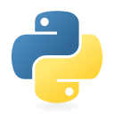

<h1 align="center">Matías Sanmiguel</h1>

<p align="center">
  <samp>BACKEND SYSTEMS / INFRASTRUCTURE / TELECOMMUNICATIONS</samp>
</p>

<p align="center">
  Building software in Buenos Aires.<br />
  <strong>Intern at Personal</strong> · <strong>Founder of Imas+</strong><br />
  <sub>Imas+ is the official computer science student club at UADE.</sub>
</p>

<p align="center">
  <a href="https://matias-sanmiguel.github.io/portfolio/">Portfolio ↗</a> &nbsp;·&nbsp;
  <a href="https://www.linkedin.com/in/matias-sanmiguel/"> LinkedIn</a> &nbsp;·&nbsp;
  <a href="mailto:matiassanmiguel240@gmail.com">Email ↗</a>
</p>

<p align="center">
  <br />
  <samp>at home on Linux.</samp>
</p>

---

### `01` / whoami

```go
package matias

type Profile struct {
    BasedIn string
    Work    string
    Founded string
    Focus   []string
}

var Me = Profile{
    BasedIn: "Buenos Aires, Argentina",
    Work:    "Personal — Intern",
    Founded: "Imas+ — UADE's official computer science student club",
    Focus: []string{
        "Backend services & data modeling",
        "Network monitoring & diagnostics",
        "Infrastructure & automation",
    },
}
```

I like working where software meets operations: designing data models, connecting services, and building tools that make systems easier to understand and run. My projects range from payment infrastructure to network diagnostics and desktop utilities.

### `02` / toolbox

<p>
   &nbsp;
   &nbsp;
   &nbsp;
   &nbsp;
   &nbsp;
   &nbsp;
   &nbsp;
   &nbsp;
</p>

| Layer | Tools |
| :--- | :--- |
| **Backend** | Java · Spring Boot · Go · Python |
| **Data** | PostgreSQL · Neo4j · Redis · MongoDB · Cassandra |
| **Infrastructure** | Linux · Docker |
| **Desktop** | Rust · FFmpeg |

### `03` / selected work

| Project | Why I built it / what to explore |
| :--- | :--- |
| **[Sashimi](https://github.com/Matias-Sanmiguel/sashimi-public)**<br />Java · Spring Boot · PostgreSQL | **Payment infrastructure for LATAM.** Fiat and crypto rails, settlement workflows, and signed webhooks. [Read the docs ↗](https://matias-sanmiguel.github.io/sashimi-public/) |
| **[Salmon](https://github.com/Matias-Sanmiguel/Salmon)**<br />Rust · Language design | **A small language for finite automata.** Lexer, parser, semantic validation, and DFA/NFA/ε-NFA simulation, with a CLI and tests against an independent evaluator. |
| **[Tintero](https://github.com/Matias-Sanmiguel/tintero)**<br />Next.js · TypeScript · Supabase | **A workspace for Imas+.** Projects, member management, inventory, a calendar, and LaTeX budgets for the UADE computer science club. |
| **[Pressure](https://github.com/Matias-Sanmiguel/Pressure)**<br />Rust · FFmpeg | **A practical desktop tool.** Video compression with hardware encoder detection, queued jobs, and live telemetry. |

<details>
<summary><strong>More to explore → data systems, experiments & Linux tools</strong></summary>

<br />

- **[Caché](https://github.com/Matias-Sanmiguel/Cache)** — Nightlife social platform using Neo4j, Redis, MongoDB, and Cassandra for different data workloads.
- **[Fly Crossy Connectome](https://github.com/Matias-Sanmiguel/fly-crossy-connectome)** — Experimental 3D game with an autonomous 80-neuron controller and live simulated neural activity. Larger controllers and parts of the biomechanics telemetry are still in progress.
- **[DosStatsPort](https://github.com/Matias-Sanmiguel/DosStatsPort)** — Linux launcher and packaging for a legacy DOS statistics suite, using DOSBox Staging and a user-supplied copy of the original software.
- **[Honeycomb](https://github.com/Matias-Sanmiguel/Honeycombv2)** — Blockchain forensics with graph algorithms implemented in Java.

</details>

### `04` / currently

**At Personal** — working on monitoring, diagnostics, and automation in telecommunications.

**At Imas+** — building the official computer science student community at UADE as its founder.

---

<p align="center">
  <samp>Let's talk systems, tools, and ideas.</samp><br />
  <a href="mailto:matiassanmiguel240@gmail.com">Get in touch ↗</a>
</p>

<p align="center"><sub><a href="assets/CREDITS.md">Artwork & icon credits</a></sub></p>
