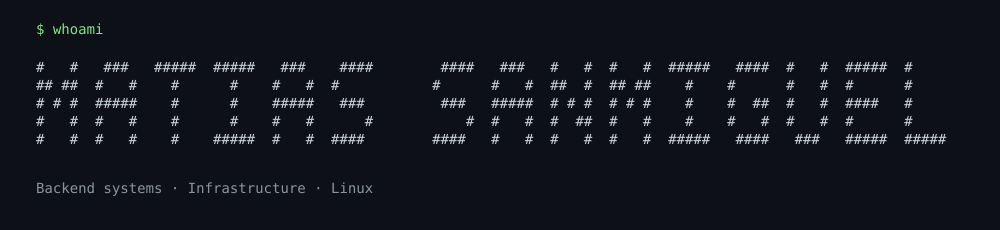

I'm **Matías Sanmiguel**, a software developer based in Buenos Aires. I'm currently an **intern at Personal** and the **founder of Imas+**, the official computer science student club at **UADE**.

My work focuses on backend systems, data modeling, and infrastructure. I like building tools that connect software with operational problems, from payment processing to network monitoring and diagnostics.

## About Me

- At **Personal**, I work on monitoring, diagnostics, and automation in telecommunications.
- I founded **Imas+** to build a computer science student community at UADE.
- My projects explore JVM backends, language design in Rust, and practical tools for Linux.
- I care about how systems store state, handle failures, and make their behavior observable.

## Selected Projects

### [Sashimi](https://github.com/Matias-Sanmiguel/sashimi-public)

A payment gateway for Latin America, built with **Java, Spring Boot, and PostgreSQL**. It brings together fiat and crypto payment rails, merchant settlement workflows, and signed webhooks. The repository includes integration tests for the payment lifecycle, authentication, and settlement.

[Documentation](https://matias-sanmiguel.github.io/sashimi-public/)

### [Salmon](https://github.com/Matias-Sanmiguel/Salmon)

A compact language and CLI for defining, validating, and simulating **finite automata**, written in **Rust**. It includes a lexer, parser, semantic validation, and DFA/NFA/ε-NFA simulation. Tests compare the simulator with an independent evaluator; CI runs checks on Linux and Windows.

### [Pressure](https://github.com/Matias-Sanmiguel/Pressure)

A desktop video compressor built with **Rust and FFmpeg**. It detects available hardware encoders, falls back to CPU encoding, and processes a queue of videos with live progress and telemetry.

Other projects and experiments

- **[DosStatsPort](https://github.com/Matias-Sanmiguel/DosStatsPort)** — Linux launcher and packaging for a legacy DOS statistics suite, using DOSBox Staging and a user-supplied copy of the original software.
- **[Caché](https://github.com/Matias-Sanmiguel/Cache)** — A nightlife social platform with Neo4j, Redis, MongoDB, and Cassandra serving different data workloads.
- **[Fly Crossy Connectome](https://github.com/Matias-Sanmiguel/fly-crossy-connectome)** — Experimental 3D game with an autonomous 80-neuron controller and live simulated neural activity. Larger controllers and parts of the biomechanics telemetry remain in progress.
- **[Honeycomb](https://github.com/Matias-Sanmiguel/Honeycombv2)** — Blockchain forensics with graph algorithms implemented in Java.

## Tech Stack

Technologies used across my projects:

I've also worked with **Neo4j, Cassandra, and FFmpeg**.

## Community

As the founder of **Imas+**, I'm building the official computer science student community at UADE alongside my technical work.

## Find Me

[Portfolio](https://matias-sanmiguel.github.io/portfolio/) · [LinkedIn](https://www.linkedin.com/in/matias-sanmiguel/) · [Email](mailto:matiassanmiguel240@gmail.com)

---

At home on Linux. · [Artwork credits](assets/CREDITS.md)
